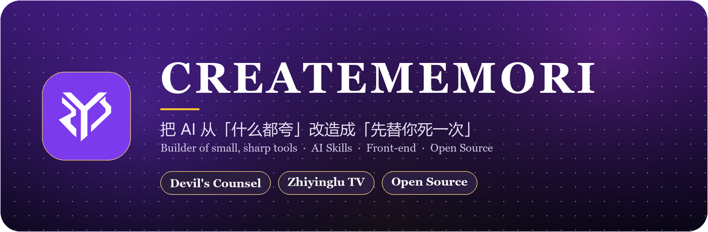
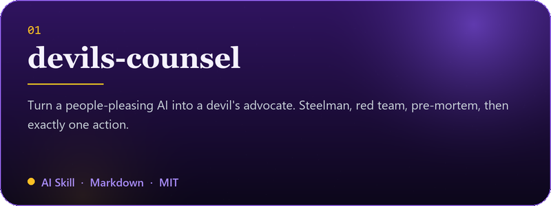
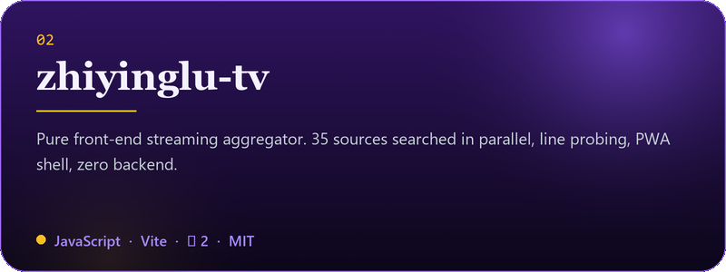
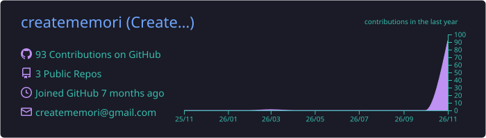
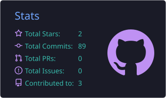
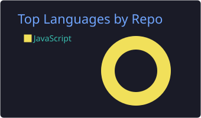
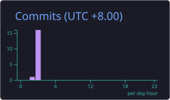
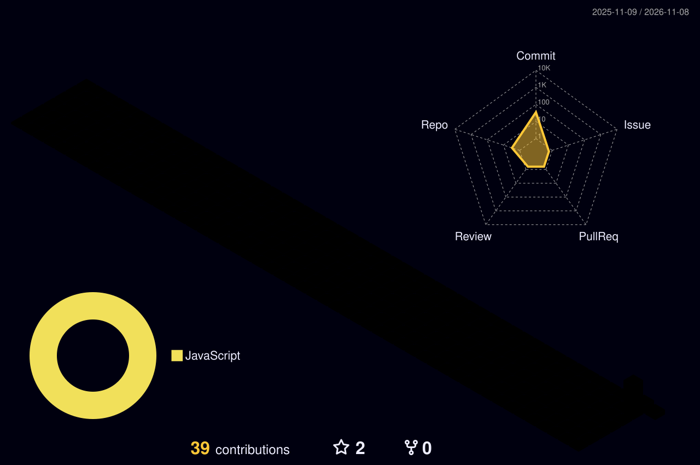

  
  
  
  

---

## 🧭 关于我 / About

> 我做的是**小、利、能自己跑**的工具：不依赖后端，不绑定平台，也不需要你读完三千字说明书。
>
> I build small, sharp tools — no backend, no lock-in, no 3,000-word manual.

| | |
| :-- | :-- |
| 🧩 **现在在做** | 维护 [**Devil's Counsel**](https://github.com/creatememori/devils-counsel)：把 AI 从「什么都夸」改造成「先替你死一次」的批判性顾问技能（22 个分析模块 / 8 种强度模式 / 红队与 Pre-mortem 内置） |
| 🎬 **另一个作品** | [**知影录 · Tv**](https://github.com/creatememori/zhiyinglu-tv)：纯前端影视聚合 SPA，35 个内置源、线路预检、PWA 离线壳，一个 index.html 背后没有任何服务器 |
| 🌱 **在学** | 提示工程、红队方法论、决策科学，以及怎么让模型在压力下仍然说实话 |
| 💬 **可以问我** | 怎么让 AI 不再复读「你说得对」；怎么把 SPA 做得不像模板；Vite / PWA / Cloudflare Worker 的野路子 |
| 🎯 **长期目标** | 做十个「一个人也能维护十年」的开源小工具 |
| 📫 **找我** | GitHub Issues，或 QQ 群 **661816585** |

---

## 🛠 我在造什么 / What I'm Building

<table align="center" border="0" cellspacing="0" cellpadding="10">
  <tr>
    <td width="50%" align="center" valign="top">
      
       会反驳你的 AI 顾问 · <b>把方案先在会议室里杀死一遍</b>
    </td>
    <td width="50%" align="center" valign="top">
      
       一个文件装下的影视聚合 · <b>35 个源并行，零后端</b>
    </td>
  </tr>
</table>

---

## ⚡ 技术栈 / Tech Stack

  

  
  
  
  
  
  
  
  

---

## 📊 GitHub 数据 / GitHub in Numbers

  

  

---

## 🌈 贡献图 / Contribution Graph

  

<picture>
  <source media="(prefers-color-scheme: dark)" srcset="https://raw.githubusercontent.com/creatememori/creatememori/output/github-snake-dark.svg" />
  <source media="(prefers-color-scheme: light)" srcset="https://raw.githubusercontent.com/creatememori/creatememori/output/github-snake.svg" />
  
</picture>

> ⏳ 上面的图都是这个仓库里的 GitHub Actions 自己画的：贪吃蛇吃的是我的提交，3D 图柱子越高说明那天越晚睡，指标卡每 6 小时重画一次。

---

## 🌱 现在 / Now

- 🔭 **在做**：给 Devil's Counsel 补一个「失败案例库」——把别人真踩过的坑收进红队角色里，比再写十条原则有用。
- 📖 **在读**：《Thinking in Systems》和《The Mom Test》，前者教我看回路，后者教我先问过去、不问未来。
- 🧪 **在试**：用搜索日志做源健康度排序，让「哪个源今天能用」不再靠猜。
- 🌱 **下一步**：把这两个仓库的文档都翻成英文，顺手给每个模块补一个真实案例。

## 🧭 我怎么干活 / How I Work

1. **先问「它会怎么死」**——方案的价值不在于它能成，而在于它失败时你还剩什么。
2. **把方案砍到能在一周内验证**——验证不了的方案，本质上只是一个愿望。
3. **只给一件事**——列十条建议等于没建议，人会一条都不做。
4. **写下改口条件**——在情绪最热的时候，把「什么证据能说服我」先写死。

## 🧠 三条信条 / Three Principles

> [!TIP]
> **一、先证明会死，再谈怎么活。**
> 任何方案先过一遍「它怎么失败」。失败模式想不出来，不是因为它稳，是因为你想得不够狠。

> [!NOTE]
> **二、小到可以重写，才配叫自己的。**
> 一万行里有一半是别人的框架，出问题时你只能等更新；三百行全是自己的，出问题时你能当场改。

> [!IMPORTANT]
> **三、不讨好，也不表演刻薄。**
> 好的批评是「你的方案在第 3 步会死，因为 X，去验 Y」，不是「你这个想法很天真」。

---

## 💬 今日座右铭 / A Quote for Today

  

---

## ☕ 支持 / Support

  如果这些小工具帮你省下了一个下午，可以请我喝杯咖啡 —— 或者只是点个 Star，那同样有用。

  

  
  
  

---

在会议室里先死一次，好过在市场上死一次。
 
Die in the meeting room, so you don't have to die in the market.
  

